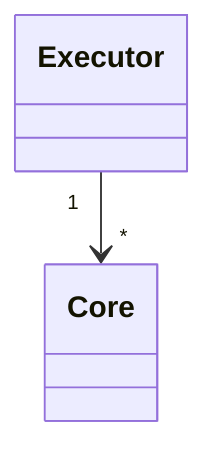

# Executors

An executor is a group of computation units (cores) that share the same work queue.
A component is executed on an arbitrary core.



Cores can be assigned specific attributes, such as stack size, CPU and priority.

```bdl
// A workload will run on either core0 or core1.
composition
{
   core0 = bzd.components.esp32.Core(stackSize = 16000, name = "core[0]", cpu = 0, priority = 50);
   core1 = bzd.components.esp32.Core(stackSize = 16000, name = "core[1]", cpu = 1, priority = 100);
   executor = bzd.components.generic.Executor(cores = list(core0, core1)) [executor];
}
```

Sometimes, for portability purposes, you might want to use a platform-specific core while keeping the executor generic.
For example, a Linux machine can be composed as follows:

```bdl
composition
{
   core = bzd.components.linux.Core(stackSize = 200000);
   executor = bzd.components.generic.Executor(cores = list(core)) [executor];
}
```

Multiple executors can be created and deployed on the same process/binary; for example, this can be useful to have different task priorities.

## Thread safety

By default a component or task is assigned to a specific core during its lifetime. This is done at runtime as the number of cores is not always known at build time.
This ensures that all resources within a component are accessible safely.

### Interaction between components

Components have various ways to interact with each other.

- They can be passed as `config`.
- They can be passed as argument through their interface.
- They can use variables to communicate.

The core on which a component runs depends on its dependencies on other components.
If a non-thread-safe component is a dependency of another component, they will both run on the same core.
A `[threadsafe]` tag to schedule a component on any available core is not implemented yet.

If the only dependency is through variables, it is also considered thread-safe.

An error will be raised if there is no possible combination. For example, if two workloads executed on different executors depend on a third component that is not thread-safe.

## Default executor

When the system only has a single executor, it is automatically assigned to all workloads, therefore there is no need for specific assignment.

## Association

If the system contains multiple executors, however, it is necessary to define where workloads are running.

This can be done in 2 different ways: either by specifying it at component instantiation with the `executor` contract,

```bdl
composition
{
   comp1 = Component [executor(linux.executor)];
}
```

or separately from the component, using the builtin function `bind`, to bind a fqn or a regular expression to an executor, for example:

```bdl
composition
{
   bind(/comp1.*/) [executor(linux.executor)];
}
```

This tells that all FQNs starting with `comp1` will be assigned to the executor `linux.executor`.
